# CS-464 Lab 7 - Comet Run menu design document

Comet Run is a small mobile game where you tap comets before the timer runs out. For this lab I only made the menus, so the gameplay screen is just a HUD mock-up that leads to Pause and Results.

Below there's one section for each of the 10 screens. Every screenshot is 1080x1920. To get all the different states into the pictures (locked, owned, selected, can't afford) I took them with some example progress: 450 coins, 3 levels cleared and the Falcon ship owned. I drew the boxes, arrows and numbered notes in magenta because that colour isn't used anywhere in the game, so you can't mix up a note with the UI. I made the greyscale versions with luminance (same as Desaturate > Luminance in GIMP).

## 01 - Title

**Purpose:** it's the first screen you see. It shows the game's name and waits for you to tap.

**Principles and techniques:**
- Hierarchy: the logo is the biggest thing on the screen, so you see it first. The tagline under it is smaller and grey, and the version text at the bottom is the smallest of all.
- Colour: orange is only on "COMET" and the comet drawing. It's the same orange I use later for the main buttons, so it turns into the "action" colour.
- Big touch target: the whole screen works as one button, and "TAP ANYWHERE TO START" in bold caps tells you what to do.
- Contrast: white and orange on dark navy are both really easy to read.
- Calm background: the planet and stars are dark, low contrast shapes so they don't pull your eye away from the logo.

**Tweens and ease curves:**
- The logo grows from 70% to full size with **OutBack (0.6 s)**. The little overshoot makes it pop, so your eye goes straight to it.
- "Tap anywhere" fades in after the logo with **OutQuad (0.4 s)**, then keeps pulsing slowly with **InOutSine (1.1 s, back and forth)**. It's soft and slow, it just shows the game is waiting for you.
- Tapping fades into the Main Menu with **OutQuad (0.45 s)**. I didn't use a slide here because this isn't going one step deeper, it's the start of the menu.

**Annotated colour screenshot:**

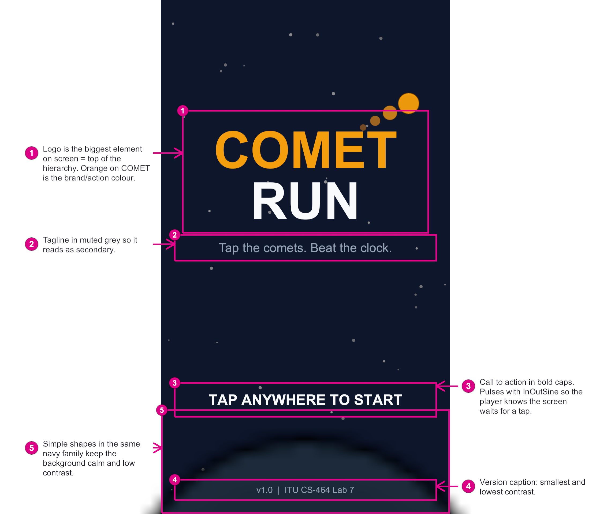

**Greyscale screenshot:**

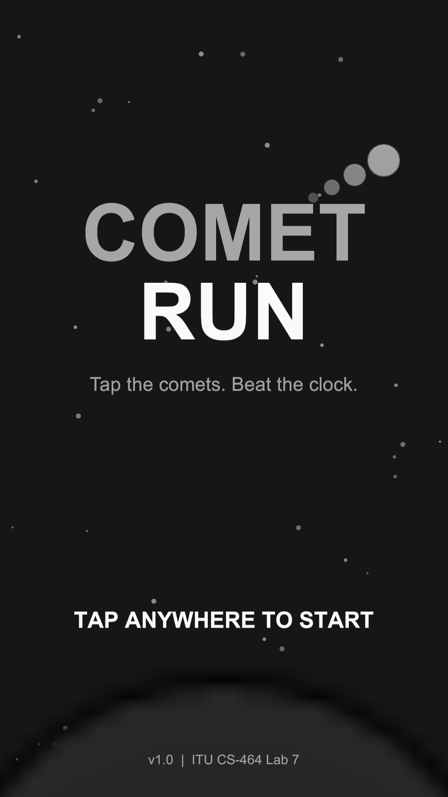

**Greyscale check:** the logo, tagline and tap text are still three clearly different greys. No change was needed.

## 02 - Main Menu

**Purpose:** the main hub. From here you go to Play, Shop, Settings or Quit, and you can see your coins and progress.

**Principles and techniques:**
- One primary action: PLAY is the biggest button and the only orange one, because that's what most people come here for.
- Grouping and alignment: Shop and Settings sit in one row under PLAY, the same total width as PLAY, and everything is centred.
- Consistency: the coin balance is in the top right, in the same spot as on every other screen that uses coins.
- Avoiding mistakes: Quit is just a plain text button at the bottom, far away from PLAY so you don't hit it by accident.
- Spacing: there's at least 60 px of space between the progress text and Quit. On short phones the screen scrolls instead of things overlapping.

**Tweens and ease curves:**
- When the screen opens, the items show up one after another from top to bottom. Each one fades in and grows from 92% with **OutCubic (0.4 s, 0.06 s apart)**. They appear in the same order as their importance.
- Opening Play, Shop or Settings slides the new screen in from the right with **OutCubic (0.35 s)**. It starts fast, so it feels like it reacted to the tap straight away, then slows down. Coming in from the right means "going deeper".
- Pressing any button shrinks it to 94% with **OutQuad (0.08 s)**, and letting go bounces it back with **OutBack (0.25 s)**, so it feels like a real button.

**Annotated colour screenshot:**

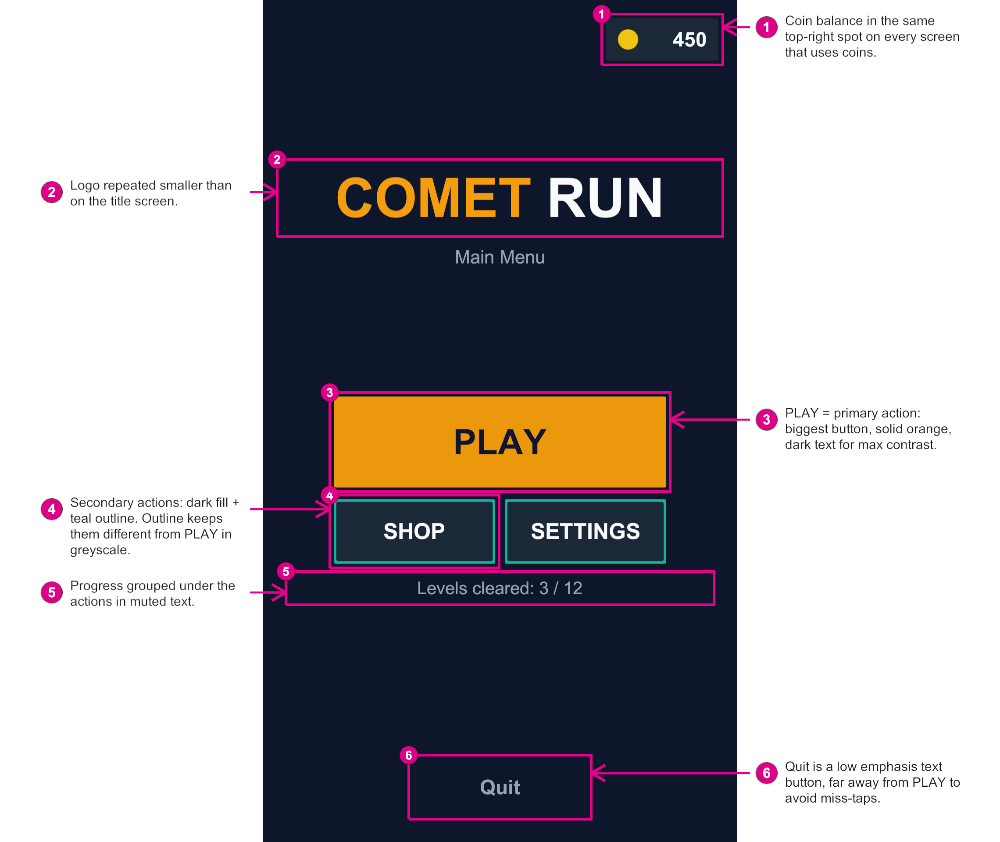

**Greyscale screenshot:**

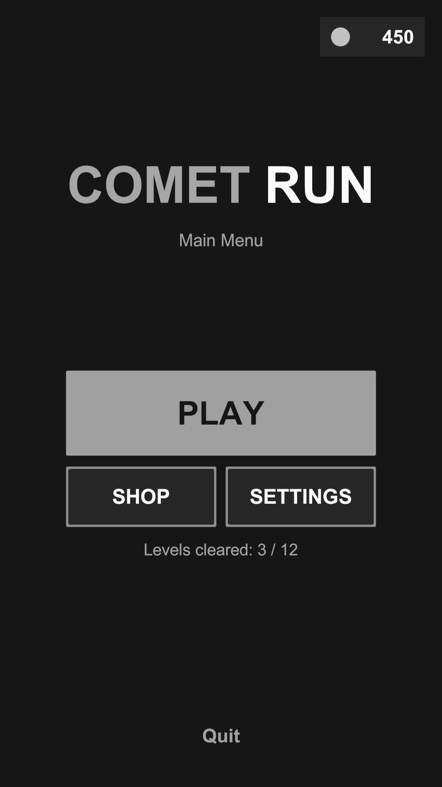

**Greyscale check:** this is where I found a problem. Orange and teal turn into almost the same grey, so when Shop and Settings were solid teal they looked just like PLAY. I changed them to a dark fill with a teal outline, and now PLAY is the only light block on the screen.

## 03 - Mode Select

**Purpose:** picking Classic, Time Attack or Endless.

**Principles and techniques:**
- Big touch targets: each mode is a large card and you can tap anywhere on it. The arrow on the right shows that it leads somewhere.
- Colour coding: each card has a coloured bar on the left (orange, teal, purple), and the time per run is written in that same colour.
- Hierarchy inside a card: big bold title, grey description, then the time info in bold at the bottom.
- Locked state: Endless is locked until you clear level 6. A locked card is darker, has a grey title and a LOCKED tag, so it doesn't rely on colour only.
- Feedback: tapping the locked card tells you exactly what you need to do to unlock it.
- Consistency: the top bar is the same as on every other screen (back on the left, title in the middle, coins on the right).

**Tweens and ease curves:**
- The cards appear one after another with **OutCubic (0.4 s, 0.07 s apart)**, top to bottom.
- Tapping the locked card shakes it left and right (a sine wave that dies down over **0.4 s**). A shake is the usual way of saying "no".
- The message slides up from the bottom with **OutCubic (0.25 s)**, stays for about 1.8 s and fades out with **InQuad**.

**Annotated colour screenshot:**

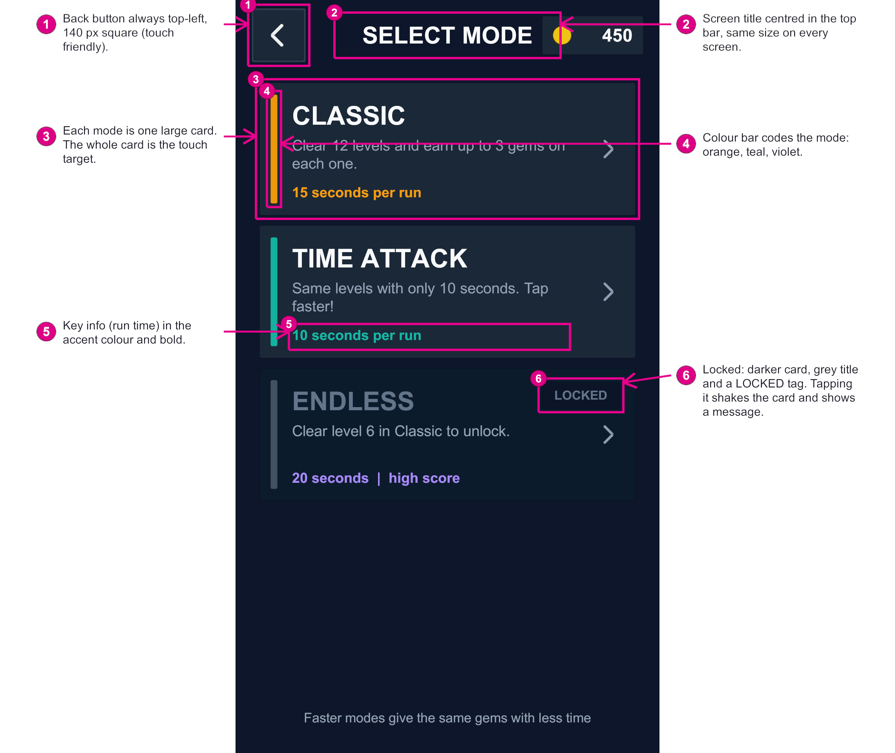

**Greyscale screenshot:**

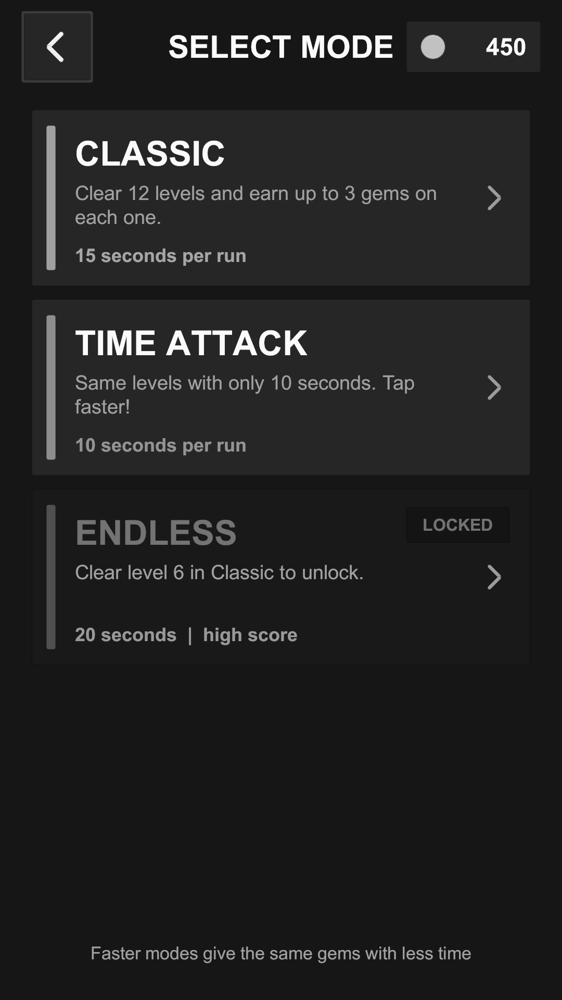

**Greyscale check:** the locked card is clearly darker and has the LOCKED tag. The three coloured bars look kind of similar in grey, but that's fine because every card has its name written on it. No change was needed.

## 04 - Level Select

**Purpose:** picking one of the 12 levels.

**Principles and techniques:**
- Grid and consistency: 3 columns, every tile is the same size (300x290) with equal 30 px gaps.
- Three clear tile states:
  - cleared levels are lighter and show gold gems for your best result
  - the next level is filled orange, so you notice it straight away
  - locked levels are the darkest, with a dim number and the word LOCKED (not just colour)
- Context: under the top bar it reminds you which mode you picked on the last screen.
- Explaining the colours: a short legend at the bottom says what orange and the gems mean.
- Feedback: tapping a locked level tells you which level you need to finish first.

**Tweens and ease curves:**
- The tiles pop in one by one, growing from 60% with **OutBack (0.3 s, 0.03 s apart)**, in the same order as the level numbers. The overshoot makes them feel bouncy and tappable.
- A locked tile uses the same **shake (0.4 s)** and message as the Mode Select screen, so "locked" always looks the same.

**Annotated colour screenshot:**

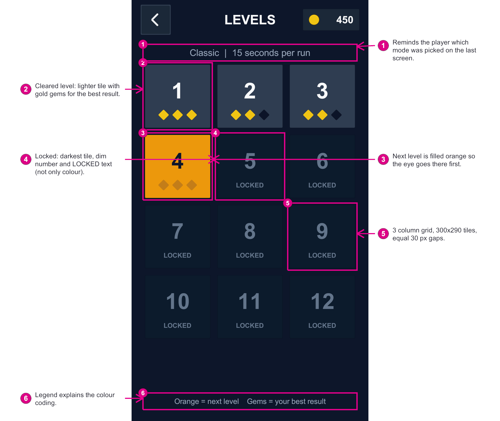

**Greyscale screenshot:**

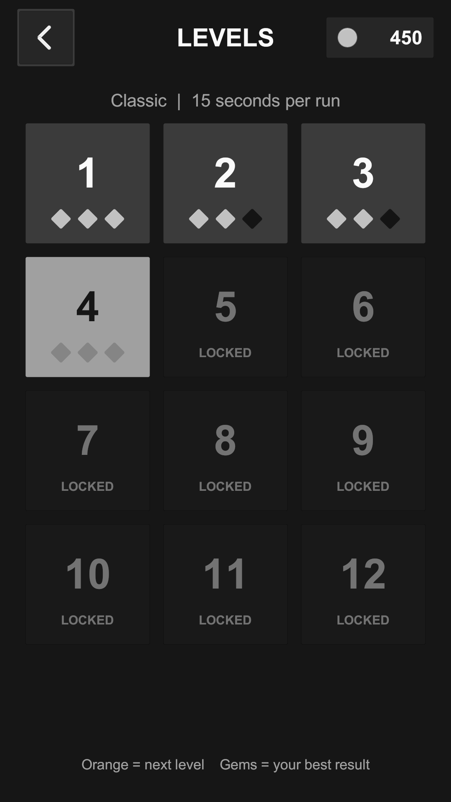

**Greyscale check:** next level (light), cleared levels (middle grey) and locked levels (almost black) are easy to tell apart. The one thing I changed was making the empty gem slots very dark, so they clearly look empty next to the bright gold ones.

## 05 - Hangar

**Purpose:** choosing which ship you fly with, then starting the run.

**Principles and techniques:**
- Context: the top line repeats the mode and level you picked, so you remember what you're about to play.
- Consistency: all three cards have the same layout (ship, name, and two stat bars with numbers).
- Selected state shown three ways: the equipped ship has a white border, an orange EQUIPPED label and the card is a bit bigger. It's not just colour.
- No dead ends: a locked ship is grey and says LOCKED. Tapping it takes you to the Shop, where you can buy it.
- One primary action: START RUN is the only orange button and it sits at the bottom where your thumb already is.
- It also shows how many Extra Time boosts you bought in the Shop.

**Tweens and ease curves:**
- When you pick a different ship, the new card grows to 105% and the old one shrinks back with **OutBack (0.3 s)**, so you can actually see the selection move.
- Tapping a locked ship opens the Shop with the normal forward slide, **OutCubic (0.35 s)**.

**Annotated colour screenshot:**

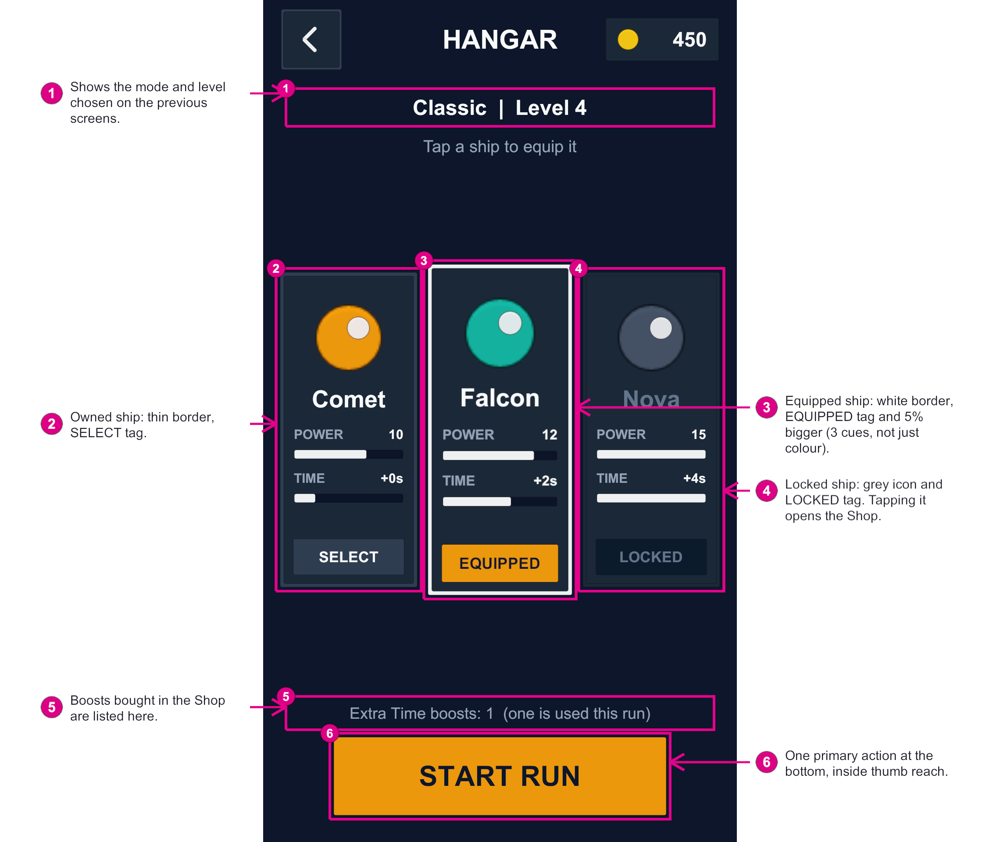

**Greyscale screenshot:**

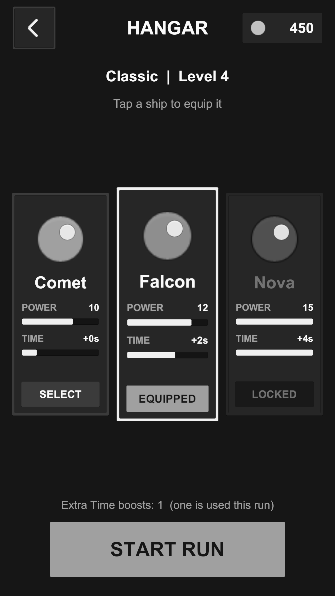

**Greyscale check:** the orange and teal ships come out as almost the same grey. That's why I changed the equipped ship so it isn't shown with colour only: it got the white border, the EQUIPPED label and the bigger size. The locked ship is clearly darker.

## 06 - Gameplay HUD

**Purpose:** shows what the HUD would look like during a run and links to Pause and Results. It isn't playable, the game area is just a placeholder with a comet in it. FINISH RUN ends the run with a set score (enough for 2 gems), so Results has numbers to show.

**Principles and techniques:**
- Consistency: the HUD bar is the same height and in the same place as the normal top bar. Pause is where the back button usually is, with the same size and style.
- Hierarchy: the score is the biggest number. The level is smaller in the top right, and the timer bar is under them so you can see the time left at a glance.
- Honest placeholder: the game area is a slightly lighter box with "GAME AREA" written in it, so it's obvious it isn't the real game.
- FINISH RUN is a secondary button because it's only there for the demo.
- The game area shrinks on short screens so the button is still reachable.

**Tweens and ease curves:**
- The pause button opens the Pause screen on top as a popup (the tweens are explained in the next section).
- FINISH RUN slides over to Results with **OutCubic (0.35 s)**, the same forward slide as everywhere else.

**Annotated colour screenshot:**

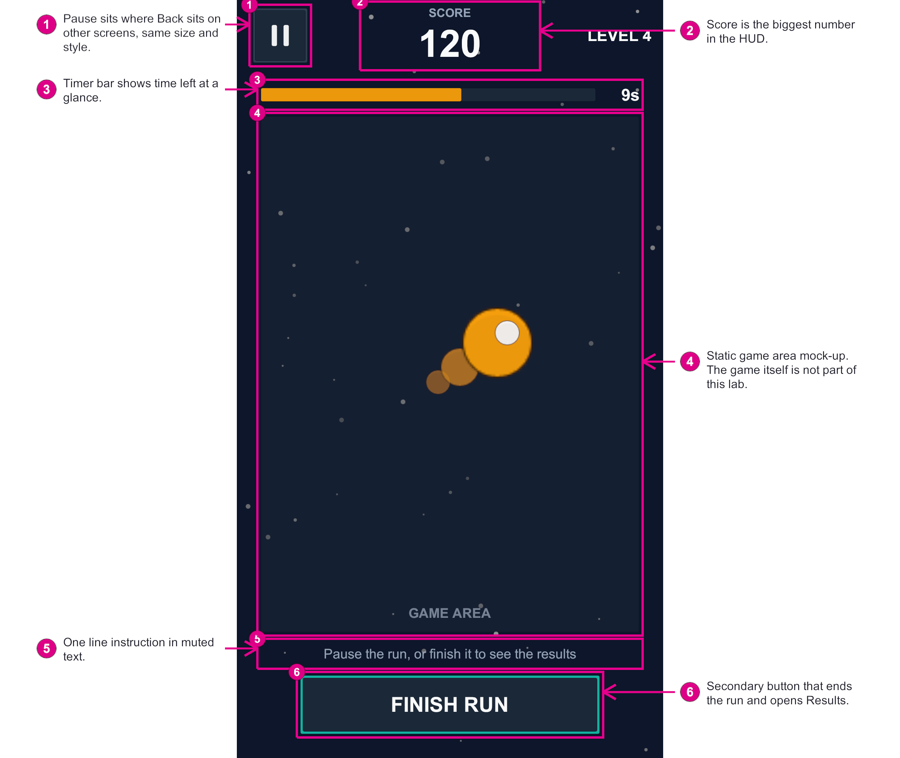

**Greyscale screenshot:**

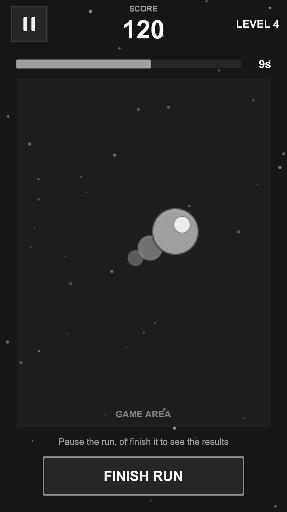

**Greyscale check:** the score is white and the timer fill is a lot lighter than its track. No change was needed.

## 07 - Pause

**Purpose:** stopping the run. From here you can Resume, Restart, open Settings or Quit to Menu.

**Principles and techniques:**
- Keeping context: it opens on top of the gameplay instead of replacing it. The game is still visible behind a 72% dark layer, so you know you're only paused.
- Order of use: PAUSED title, then the level and score, then the buttons in the order you'd most likely need them.
- One primary action: RESUME is orange and comes first. Restart and Settings are normal secondary buttons.
- Danger style: Quit to Menu is red, has a clear label and is always the last button.
- Alignment: all the buttons are the same width with the same gaps.

**Tweens and ease curves:**
- Opening: the dark background fades in with **OutQuad (0.2 s)** and the panel grows from 85% with **OutBack (0.25 s)**. The little overshoot makes it look like it popped up on top of the game.
- Closing: it fades out with **InQuad** and the panel shrinks with **InBack (0.2 s)**. It speeds up as it leaves, so it feels dismissed.
- Settings slides in on top with the normal **OutCubic (0.35 s)** slide, and its back button brings you back here. Restart closes the panel and shows a "Run restarted" message.

**Annotated colour screenshot:**

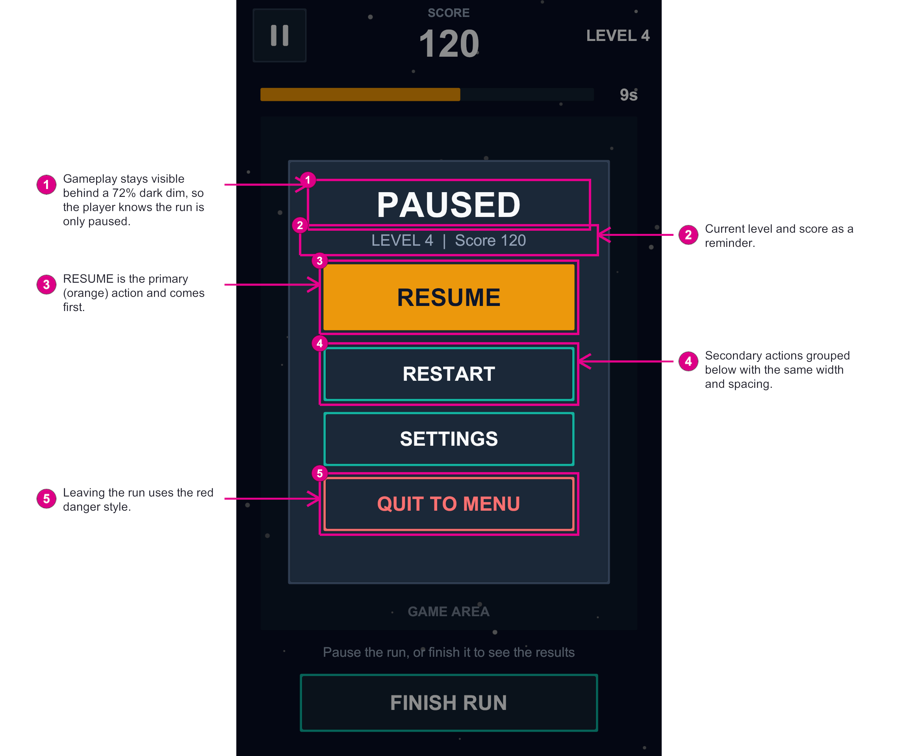

**Greyscale screenshot:**

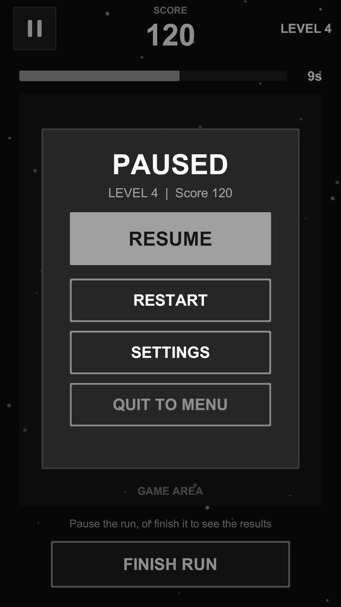

**Greyscale check:** the panel is lighter than the game behind it and Resume is the lightest button. The red of Quit came out close to the grey text, so I made sure the danger button has an outline, clear words ("QUIT TO MENU") and always sits at the bottom of the group. That way it doesn't depend on the red.

## 08 - Results

**Purpose:** shows how the run went (gems, score and coins) and what you can do next.

**Principles and techniques:**
- Clear outcome: the headline says LEVEL X CLEAR in orange when you pass, or TIME UP in red when you don't. The words change too, not just the colour.
- Grouping: gems, score and coins are together in one panel, with a line between score and coins.
- Consistency: coins and gems are gold, the same as everywhere else in the game. Gold is only ever used for rewards.
- One primary action: NEXT LEVEL is the main button. If you didn't pass, it's greyed out and says CLEAR TO CONTINUE.
- Retry and Menu are next to each other and the same size, because they're equally important.

**Tweens and ease curves:**
- The gems you earned pop in one at a time with **OutBack (0.35 s, 0.2 s apart)**, so each one feels like a small reward.
- The score counts up from 0 with **OutQuad (0.8 s)** and the coins with **OutQuad (0.6 s)**. You see the numbers go up instead of them just appearing.
- Retry goes forward to gameplay with the right-to-left slide. Next and Menu use the back slide (**OutCubic, 0.35 s**), because you're going back to an earlier screen.

**Annotated colour screenshot:**

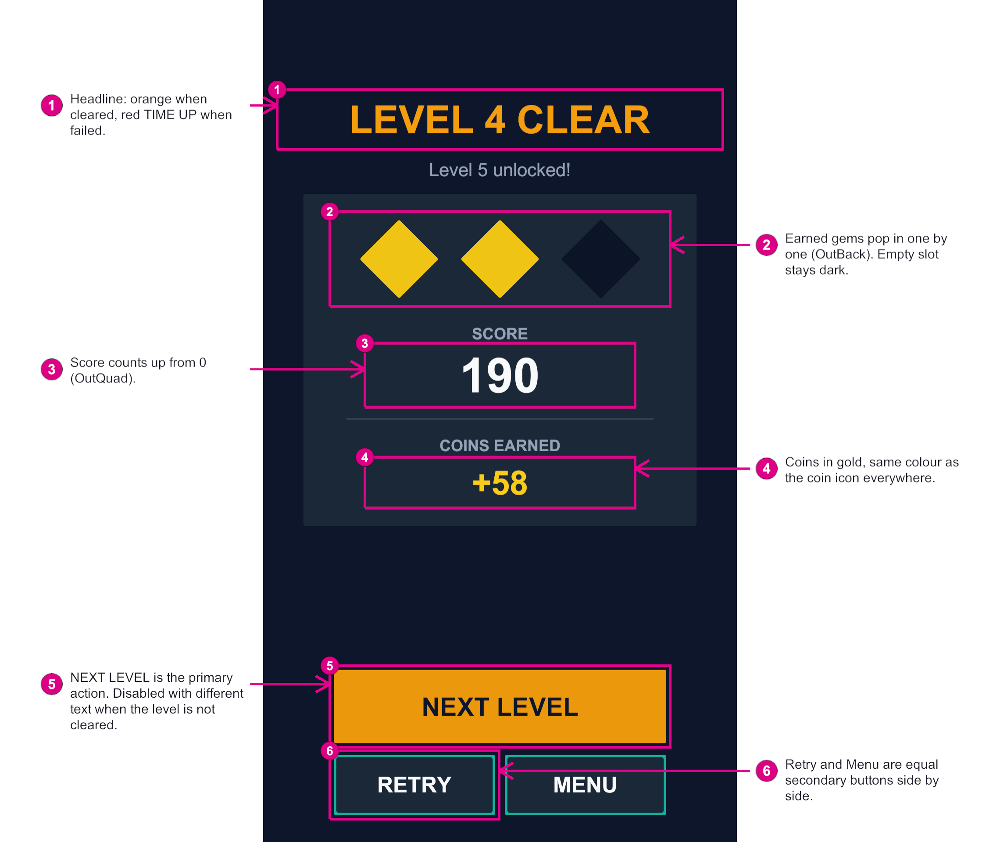

**Greyscale screenshot:**

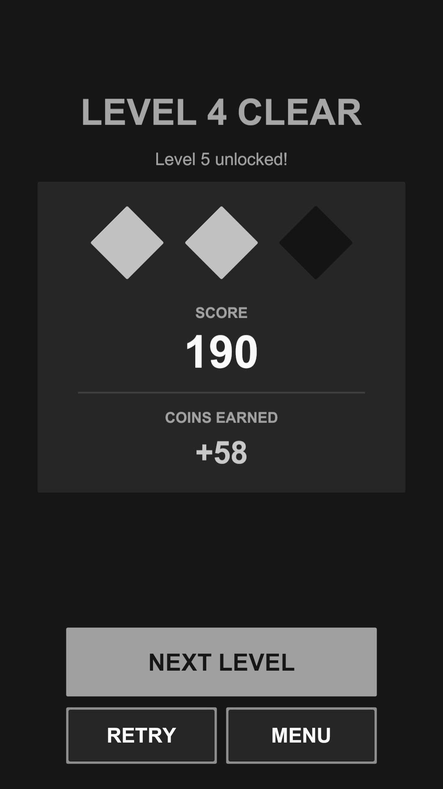

**Greyscale check:** the earned gems are light and the missing gem is nearly black, so they're easy to tell apart. No change was needed.

## 09 - Shop

**Purpose:** buying the other two ships and Extra Time boosts with your coins.

**Principles and techniques:**
- Consistency: every row has the same layout (icon on the left, name and description in the middle, buy button on the right).
- Three button states:
  - enough coins: orange, like the other main buttons
  - not enough coins: grey with the price in red
  - already owned: dark, can't be pressed, and says OWNED
- Easy comparing: your coins stay in the top bar, close to the prices.
- Consistency between screens: the ship icons use the same colours as in the Hangar.
- Feedback: buying something confirms it with a message. If you can't afford it, the message tells you how many coins you're missing.

**Tweens and ease curves:**
- The rows appear one by one with **OutCubic (0.4 s, 0.07 s apart)**.
- A successful buy makes the button do a quick bump (a sine scale up and back, **0.3 s**). The coin number counts down with **OutQuad (0.5 s)** and the coin pill bumps too, so you can see where the coins went.
- Not enough coins makes the button **shake (0.4 s)**, the same "no" as on the locked items.
- Back slides you to whichever screen opened the Shop (Main Menu or Hangar).

**Annotated colour screenshot:**

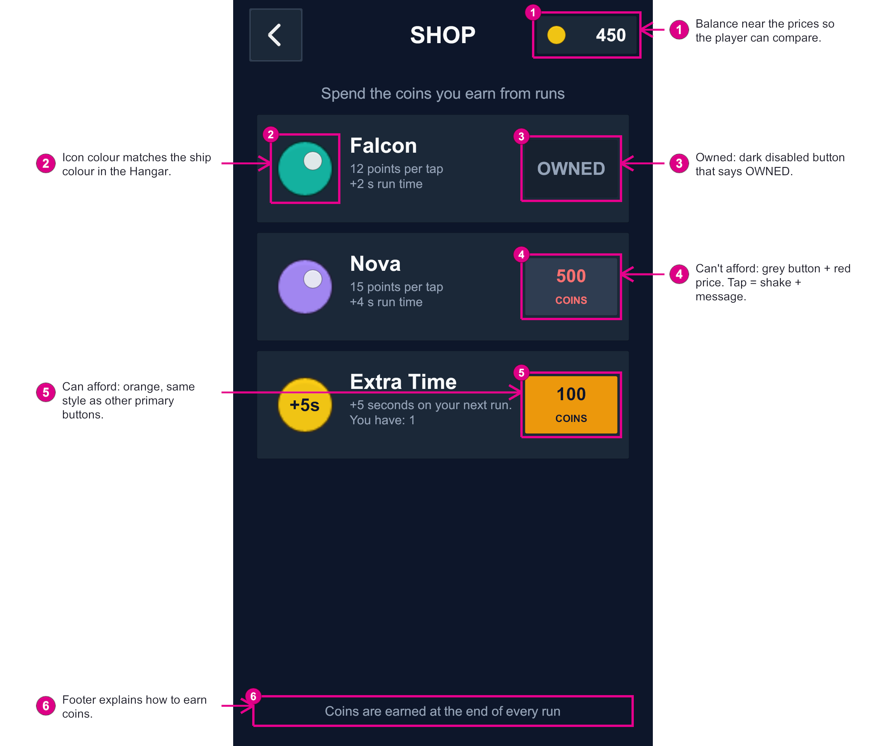

**Greyscale screenshot:**

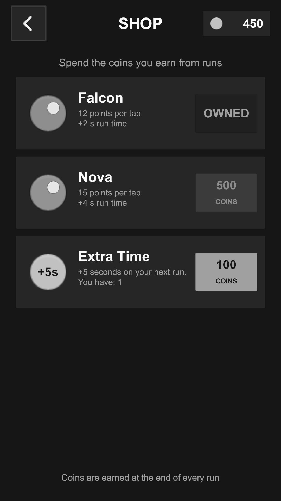

**Greyscale check:** the three button states come out light, middle and dark grey, and the owned one also has different text. No change was needed.

## 10 - Settings

**Purpose:** sound, vibration and resetting your progress. You can open it from the Main Menu or from Pause.

**Principles and techniques:**
- Grouping: the settings are under small headings (AUDIO, GAMEPLAY, DATA).
- Big touch targets: you can tap anywhere on a row (960x150) to flip its switch, not only on the small switch.
- State shown three ways: which side the knob is on, the colour, and ON/OFF text.
- The volume slider has a big 70 px handle and shows the percentage next to it.
- Preventing mistakes: RESET PROGRESS is red and on its own. You have to tap it twice within 3 seconds, and after the first tap it says TAP AGAIN TO CONFIRM.

**Tweens and ease curves:**
- The switch knob slides and the colour changes with **InOutQuad (0.18 s)**. It moves evenly, like a real switch.
- The first tap on reset gives a small **shake (0.3 s)** as a warning.
- Back slides you to wherever you came from with **OutCubic (0.35 s)**.

**Annotated colour screenshot:**

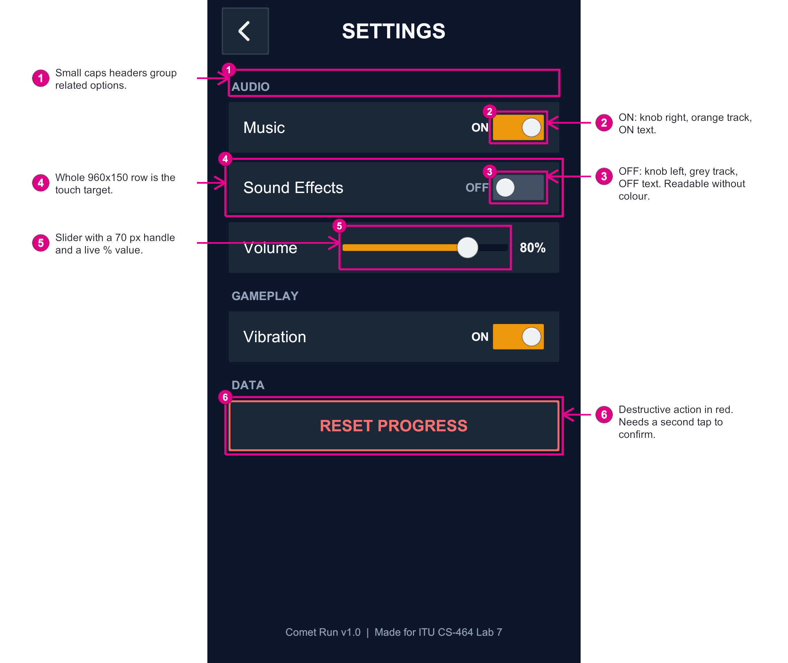

**Greyscale screenshot:**

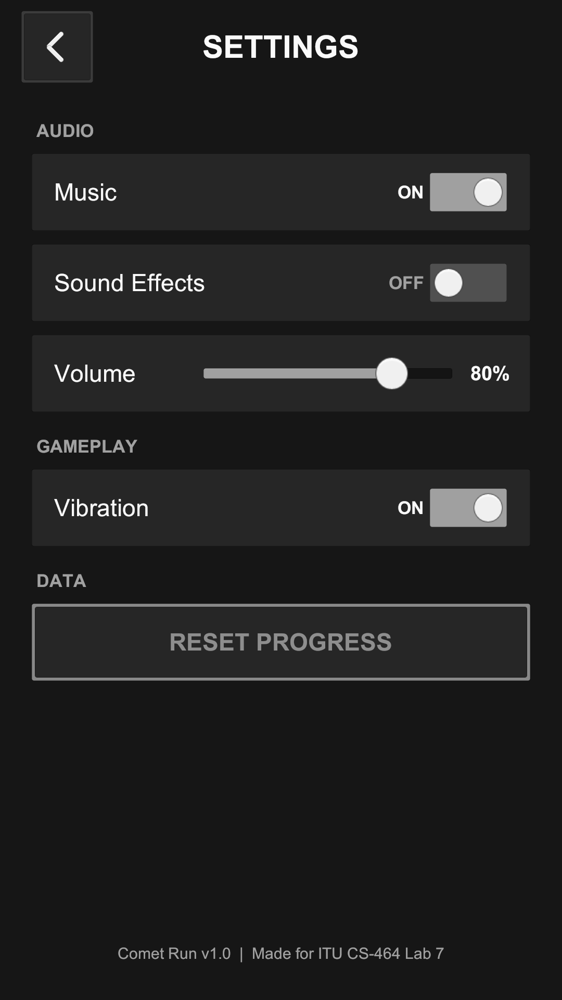

**Greyscale check:** at first the switches only changed colour, and in grey ON and OFF were hard to tell apart. I added the ON/OFF text and made the knob move sides, so now you can read it without any colour. The filled part of the volume slider is lighter than the empty part.
